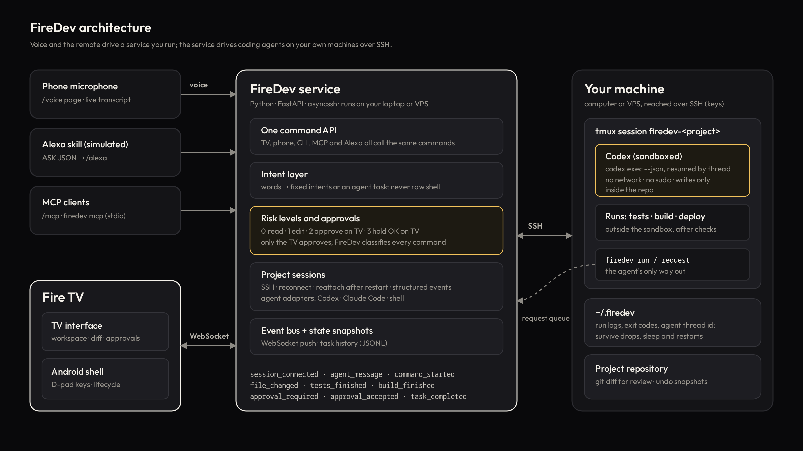

# Architecture



```
Fire TV app ── WebSocket ──▶ FireDev service ── SSH ──▶ your machine
                                  ▲                     └─ tmux session firedev-<project>
phone mic / Alexa / MCP ──────────┘                          ├─ agent turns (Codex, sandboxed)
                                                             ├─ runs: tests, build, deploy
                                                             └─ project repository
```

FireDev never hosts anyone's code. The service runs wherever you like (your laptop, the VPS itself) and
reaches your development machines over SSH with your keys.

## Pieces

| Piece | Where | What it does |
|---|---|---|
| TV interface | `tv/web` | Screens, focus engine, overlays. Plain ES modules bundled by esbuild for old WebViews. Renders from project snapshots |
| Fire TV shell | `tv/android` | Kotlin WebView host: remote keys, lifecycle, saved server address, on-device speech where it exists |
| Service | `backend/firedev` | FastAPI app: WebSocket for TVs and phones, REST for the CLI, `/mcp`, `/alexa` |
| Remote helpers | `remote/bin` | Three bash scripts FireDev installs in `~/.firedev/bin` on each connect |

### Service modules

- `config.py`: machines and projects from YAML. Secrets never live in it.
- `ssh.py`: one asyncssh connection per project, with keepalives, `run`, streaming and friendly errors.
- `session.py`: the heart. Prepares the project (folder check, tmux session, helpers, agent check), starts
  *runs*, follows their logs, turns agent output into events, runs the task queue, handles agent requests,
  and reconnects or reattaches.
- `agents/`: adapters. `CodexAdapter` (`codex exec --json`, resumed with `codex exec resume <thread>`),
  `ClaudeAdapter` (`claude -p --output-format stream-json --resume <session>`), and `ShellAdapter`. Each
  turns its own output format into the same normalised events: thread, message, plan, command started and
  finished, file changed, turn completed, error. Adding an agent means writing one `turn_command` and one parser.
- `risk.py`: classifies any command into levels 0–3 (see [SECURITY.md](SECURITY.md)).
- `intents.py`: utterance → one of a fixed set of intents, or a task for the agent.
- `service.py`: the single command API (`open_project`, `send_agent_task`, `run_action`,
  `get_project_status`, `get_current_task`, `get_build_status`, `approve_action`, `reject_action`,
  `cancel_task`, `continue_task`, `undo_changes`, …) with role checks, plus approvals and voice.
- `events.py`: event envelope, bus and JSONL history per project.
- `mcp.py`, `alexa.py`: thin translators onto the same command API.
- `preview.py`, `gateway.py`, `preview_intents.py`: live previews of the project's own web app (below).

## Runs: why the agent survives everything

Everything FireDev starts on the remote machine is a *run*:

```
~/.firedev/projects/<project>/runs/<run-id>/
    cmd.sh      the command, wrapped: cd, env, tee to out.log, write exit_code
    out.log     everything it printed
    exit_code   written when it finishes
    meta.json   kind, title, task, risk level (enough to rebuild state after a restart)
    window      the tmux window it runs in
```

Each run is a window in the project's tmux session (`tmux attach -t firedev-pulse` shows it live). FireDev
follows `out.log` with `firedev-follow <dir> <offset>`, counting bytes as it goes:

- **TV sleeps or changes screens**: nothing happens to the run. The TV gets a full snapshot when it comes back.
- **The network drops**: the run continues. FireDev reconnects with backoff and resumes following from its offset, with no gaps or duplicates (tested).
- **FireDev restarts**: on connect it lists runs with no `exit_code` whose tmux window still exists, rebuilds
  their tasks from `meta.json` and re-reads their logs. New tasks wait for a reattached agent turn to finish (tested).
- **Stop**: FireDev kills the run's tmux window.

The agent conversation is persistent too. Codex's thread id is saved in `~/.firedev/projects/<id>/agent.json`, and
every task after the first is a `codex exec resume <thread>` turn, so "fix it" knows what "it" is.

Both remote helpers exit as soon as the SSH session that started them is gone, so a dropped connection never
leaves a watcher behind that swallows requests (a regression test covers this).

## The agent's only way out: the request queue

Codex runs with `sandbox_mode=workspace-write` and no network: it can read anything and write only inside the
project (and any `writable_roots`). Builds, tests and anything outside the project go through the helper:

```
firedev run test                                     # a declared project action
firedev request --reason "why" -- git push origin    # anything else
```

The helper writes `<project>/.firedev/queue/<id>.req`. FireDev's watcher claims it (`.taken`), classifies the
command *itself*, asks the TV when the level needs it, runs it as a normal run outside the sandbox, and writes
`<id>.state` (`waiting`, `running <dir>`, `rejected <why>`). The helper streams the run's output back to the
agent and exits with its code, so to the agent it looks like an ordinary command that took a while. A rejection
reaches the agent as "Rejected on the TV… do not retry".

The same route gives the TV structured results: when the agent runs the tests through FireDev, FireDev reads
the JUnit XML and the TV shows "18 / 18 passed" from real data, not from scraping.

## Events

Every event has the envelope `{type, id, ts, project, task, data}`:

```
session_connecting session_connected session_disconnected session_error
voice_listening voice_partial voice_command voice_reply
agent_started agent_message agent_status agent_plan
command_started command_output command_finished file_changed
tests_started tests_finished build_started build_finished deploy_started deploy_finished
approval_required approval_accepted approval_rejected
task_queued task_started task_completed task_failed task_cancelled changes_undone state
```

After any change the service pushes a coalesced `state` snapshot of the project (at most every 120 ms). The TV
renders screens from snapshots and uses the named events only for moments: the approval sheet, the voice sheet,
result cards. A reconnecting TV is correct after one message.

## Voice and assistants

```
phone (/voice)  ─┐
Alexa (/alexa)  ─┼─▶ intents.parse() ─▶ fixed intent ─▶ command API ─▶ session
MCP (/mcp)      ─┤                    └▶ agent task  ─▶ sandboxed agent
TV quick picks  ─┘
```

Voice never becomes a shell command. Alexa intents map to the same canonical sentences the phone sends, so
every source shares one safety path. Approving by voice only moves the TV's focus to Approve: the press must
come from the remote.

## Live preview: the real app on the TV

```
TV (sandboxed frame) ── TV connection to the user machine ── preview gateway :8132 ── SSH direct-tcpip ──▶ 127.0.0.1:<port> on the dev machine
                                              (same process)          (the project's own SSH connection)
```

When the agent builds or changes something visible, the TV shows the project's actual running web app, not a
screenshot. localhost on the TV is not localhost on the dev machine, so the page travels through FireDev.

- `preview.py` detects what a project is with one SSH command: the framework from `package.json` (Vite, Next.js,
  Nuxt, SvelteKit, Astro, Remix, Expo web, Angular, Create React App, Vue CLI, Gatsby, Parcel, webpack, or a
  `dev`/`start` script), a static site (`index.html`), or a native app (Android, iOS, Flutter, React Native). It also
  lists the ports the project's own processes listen on (`ss -ltnp`, each pid's cwd), so a `npm run dev` the user
  started is adopted rather than duplicated. A project can set `preview: {command, port, path, dir, auto_open}`.
- FireDev-managed dev servers run in the project's tmux session, window `preview`, bound to 127.0.0.1 on a port
  chosen per project (stable, and never one already in use), with `~/.firedev/projects/<id>/preview/{cmd.sh,meta.json,out.log}`.
  They outlive the TV, network drops and FireDev restarts; on reconnect FireDev finds the window and the port again.
- `gateway.py` is a second listener with its own origin. It forwards HTTP (streamed both ways, so SSE works) and
  WebSockets (so Vite, Next.js and webpack hot reload work as on localhost) through an SSH port forward that is
  rebuilt when the connection is. Host and Origin are rewritten to `127.0.0.1:<port>`, redirects to the dev server
  become relative, `X-Frame-Options`/`frame-ancestors` are dropped, and HTML gets one script tag: `/__firedev/tv.js`.
- `preview_tv.js` runs in the page. FireDev keeps the remote: while you "use the page", it posts the arrow keys and OK
  into the frame, and the helper moves a focus ring between links, buttons and fields, clicks, scrolls, and reports
  the page, its title and console errors back (the agent sees those errors in its next prompt and in
  `firedev preview status`). Back always returns to FireDev.
- Reloads: hot-reload servers update themselves. For servers without it (static sites, plain scripts), FireDev
  reloads the frame when the agent changes a file and when a remote file watcher sees a save, only while a TV watches.
- Offers: when an agent turn changed web files (from file events, or git for files written from the shell), FireDev
  offers the preview on the TV, or opens it beside the agent when the request was visibly about the UI. The agent can
  also run `firedev preview open [/path]` itself.
- Native apps get an honest "no web preview": FireDev doesn't run them in a WebView. It offers what exists instead:
  building the app, the screenshot images the project's tests left in the repository, a web target if there is one.

TV side: `screens/preview.js` (split with the agent's work, or full screen; four split sizes; desktop, tablet and
mobile viewports at their real CSS widths; zoom changes that width) and `preview.js` (one-time addresses, messages
from the page, offers, voice actions). Voice: `preview_intents.py` ("show me the preview", "full screen", "go back to
Codex", "show me the mobile version", "zoom in", "go to the pricing page", "start the dev server"...). While the
preview is on screen, "make the header smaller" goes to the coding agent as a change to the site. Generated screens can
include the running app as `{"type": "preview", "url": "live"}` next to charts or diagrams.

## TV interface

- 1920×1080 stage scaled to the screen (the Fire TV WebView reports 960×540 at density 2).
- Focus engine: a layer stack (screen, overlays, approval always on top). Arrows move to the nearest control in
  that direction; re-renders keep focus by `data-focus-id`.
- Screens: Home, Workspace, Activity, Changes (diff), plus pairing and connecting. Overlays: approval, voice,
  results, build and test details, terminal output, phone link.
- Remote: arrows, OK, Back (never approves; on Home it asks before leaving), ☰ / Play-Pause for voice.
