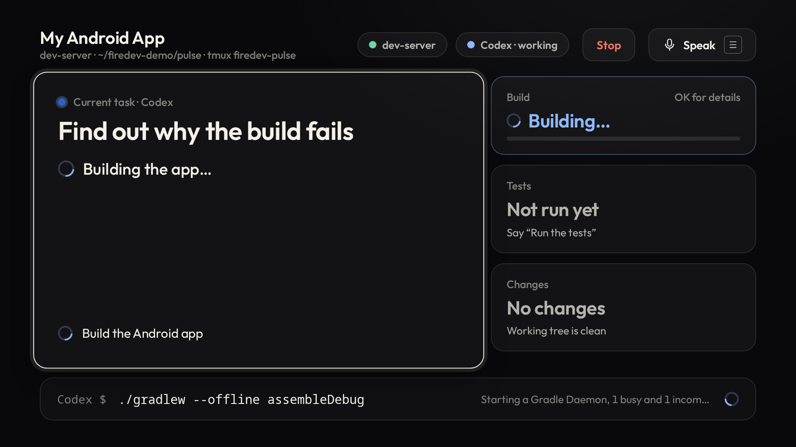

# FireDev

**FireDev turns Fire TV into a voice-first development workstation, letting developers control AI coding agents running on remote machines through SSH.**

Pick a project with the remote. Say *"Why is the build failing?"*. Codex investigates on your own machine
while the TV shows what it is doing, in type you can read from the sofa. Say *"Fix it and run the tests"* and
watch the edits, the test count and the build. Say *"Deploy the preview"* and FireDev stops: it shows the
exact command, the reason and the risk, and nothing runs until you press Approve on the remote.



FireDev is not a terminal on a TV, speech-to-shell, or remote desktop. The coding agent does the work. The
TV is where you watch progress, inspect diffs, errors and tests, and approve anything risky. Your voice is
how you give instructions.

- [ARCHITECTURE.md](ARCHITECTURE.md): how it fits together
- [SECURITY.md](SECURITY.md): the safety model, risk levels and approvals
- [DEMO.md](DEMO.md): the 60–90 second demo, step by step
- [docs/DEVPOST.md](docs/DEVPOST.md): hackathon write-up
- [docs/VIDEO_PLAN.md](docs/VIDEO_PLAN.md): shot list for the demo video

## What works, what's simulated, what's next

| | Status |
|---|---|
| SSH to your machine with keys (asyncssh), reconnect with backoff | **Working**, tested against a real sshd |
| Persistent tmux session per project; runs keep going when the TV sleeps or the network drops | **Working**, tested (drop, reconnect, no lost output) |
| FireDev restarts and reattaches to a running agent turn | **Working**, tested |
| Codex: real `codex exec --json` turns in its workspace-write sandbox, resumed by thread id | **Working**, full demo journey passes against real Codex (about 75 s) |
| Structured events: agent steps, commands, file changes, tests (JUnit XML), build errors, deploys | **Working** |
| Risk levels 0–3, approvals on the TV, held confirmation for level 3 | **Working**, tested with remote keys |
| Agent requests outside its sandbox (`firedev run`, `firedev request`) gated by the TV | **Working**, tested |
| Diff review, raw terminal output, undo of the agent's last change | **Working**, tested |
| Live preview: the project's real running web app on the TV beside the agent or full screen; desktop, tablet and mobile widths, zoom, remote navigation inside the page, voice control; dev servers detected (Vite, Next.js, Expo web, static…) or started in tmux; preview gateway over SSH with hot reload, own origin, one-time tickets | **Working** in the browser and over real SSH: 41 unit/SSH tests (incl. an SSH drop and a FireDev restart), 7 browser tests driven by remote keys and voice, and on a real Fire TV |
| Native apps in the preview | Reported honestly (no web preview); offers the build, screenshot images in the repository, or a web target |
| Fire TV app (Kotlin WebView shell + TV interface), D-pad only | **Working** in the browser at 1080p (14 browser tests, incl. a 960×540 TV-viewport fit check) and when loaded the way the APK loads it (`tools/shell-sim.mjs`); APK builds and runs on a real Fire TV (sideloaded) |
| Phone microphone and remote (`/voice`): live transcript on the TV, typed fallback, D-pad + OK + Back that move around FireDev on the TV (OK must be held two seconds to approve from the phone) | **Working** (tested in a phone-sized browser, with streamed partial transcripts and remote-key browser tests). Browser speech recognition needs HTTPS |
| Pairing a TV with a 6-digit code | **Working**, tested |
| MCP server (`/mcp`, `firedev mcp` stdio) | **Working**: unit-tested, and the stdio bridge was exercised against the running service |
| Claude Code adapter (`claude -p --output-format stream-json`) | **Working**: a real turn through FireDev ran the tests via the helper (`tools/claude_check.py`) |
| Plain shell adapter | Implemented |
| Alexa skill (`/alexa`, [docs/ALEXA.md](docs/ALEXA.md)) | **Endpoint working and tested**: Alexa request signatures and timestamps verified, accounts linked by holding OK on the TV, tasks answered within Alexa's time limit, progress and results by voice, approvals stay on the TV. **Not yet tried with real Alexa or the Fire TV remote's microphone** (needs the skill created in the Alexa console) |
| On-device speech on the TV | Used if the device has a recogniser; most Fire TVs don't |
| Multiple machines in one UI, project setup from the TV, Alexa+ integration | Future |

## Quick start: your TV, your computer, nothing hosted

FireDev runs on your own machine and the Fire TV connects to it directly. There is no FireDev account, cloud
service, relay or DNS to set up, and nobody but you hosts anything.

**On your computer** (where your code, Codex and Claude Code live):

```bash
git clone https://github.com/MusaInc/FireDev ~/firedev && cd ~/firedev
tools/setup.sh && tools/install-cli.sh      # venv, TV bundle, `firedev` on PATH, and `firedev init`
firedev add ~/code/my-app                   # each project you want on the TV (--agent codex|claude|shell)
firedev serve                               # or `firedev up` to run it in the background
```

**On the TV**, open FireDev. It works one of two ways:

- **Same Wi-Fi**: the TV lists computers running FireDev (they announce themselves on the LAN). Pick yours; the TV
  shows a 6-digit code; run `firedev pair <code>` on the computer. The connection is TLS, and the code is derived from
  the computer's certificate as the TV saw it, so a device in the middle can't get paired.
- **A server over SSH** (a VPS, a workstation at the office): enter the address and your user name, check the
  server's fingerprint (`ssh-keygen -lf /etc/ssh/ssh_host_ed25519_key.pub`), and either type your password once (the TV
  adds its own key to `~/.ssh/authorized_keys` and forgets the password) or scan the TV's key as a QR code and add it
  yourself. FireDev must be installed on the server (the same three commands, `firedev init --no-lan`); the TV starts
  it with `firedev up` and gets its own token over SSH.

Away from home with a computer behind a home router: the TV needs either an SSH server it can reach, or your own VPN
(Tailscale, ZeroTier, WireGuard) so the computer looks local. FireDev has no relay of its own, by design.

Afterwards the TV reconnects by itself: it keeps the machine, the pinned certificate or host key, and its own SSH key
(in the Android keystore where the TV has one). Projects (say "show my projects") → the connection card changes or forgets the machine.

Inside the TV app everything the interface does goes to `127.0.0.1` relays that the app carries over that TLS or SSH
connection, live previews included (their own port, their own origin). See [docs/LOCAL_FIRST.md](docs/LOCAL_FIRST.md).

Alexa is optional and bring-your-own (it needs a public HTTPS endpoint you run; see [docs/ALEXA.md](docs/ALEXA.md)). The
normal way to talk is the TV's own microphone and speech, or the phone page on your Wi-Fi.

## Requirements

- **Service machine** (laptop or VPS): Python 3.11+, Node 18+ (only to rebuild the TV interface), and SSH access to your dev machine.
- **Dev machine** (can be the same box): `tmux`, `git`, `bash`, and [Codex CLI](https://github.com/openai/codex) signed in (`codex login`). Optional: Claude Code.
- **Fire TV** in developer mode (Settings → My Fire TV → Developer options → Install unknown apps / ADB debugging), on a network that can reach the service.

## Setup (a FireDev service that drives other machines over SSH)

The quick start above is the normal setup. This one is for a FireDev service on one machine that works on projects on
others over SSH (and for the hosted demo deployment).

```bash
git clone https://github.com/MusaInc/FireDev firedev && cd firedev
tools/setup.sh                 # venv, TV bundle, ~/.config/firedev/firedev.yaml
tools/install-cli.sh           # puts `firedev` on PATH (/usr/local/bin symlink)
```

### 1. SSH key for FireDev

Use a dedicated key, so you can revoke FireDev without touching your other access:

```bash
mkdir -p ~/.config/firedev/keys
ssh-keygen -t ed25519 -N '' -C firedev -f ~/.config/firedev/keys/firedev_ed25519
ssh-copy-id -i ~/.config/firedev/keys/firedev_ed25519.pub you@dev-server
ssh -i ~/.config/firedev/keys/firedev_ed25519 you@dev-server true   # records the host key in known_hosts
```

FireDev checks host keys against `~/.ssh/known_hosts` and never stores passwords. If you must use a password,
set `auth: password` and `password_env: SOME_VAR`; the password is read from that environment variable.

### 2. Connect a machine and a project

Edit `~/.config/firedev/firedev.yaml` (the example is [config/firedev.example.yaml](config/firedev.example.yaml)):

```yaml
machines:
  dev-server:
    host: 203.0.113.10
    user: alex
    auth: key
    key_file: ~/.config/firedev/keys/firedev_ed25519

projects:
  - id: pulse
    name: My Android App
    machine: dev-server
    path: ~/code/pulse
    agent: codex                 # codex | claude | shell
    tmux_session: firedev-pulse
    actions:                     # what "run the tests", "build", "deploy" mean for this project
      test:   { kind: tests,  run: ./gradlew testDebugUnitTest, reports: "app/build/test-results/**/*.xml" }
      build:  { kind: build,  run: ./gradlew assembleDebug, artifact: app/build/outputs/apk/debug/app-debug.apk }
      deploy_preview: { kind: deploy, level: 2, run: ./scripts/deploy-preview.sh,
                        reason: "Publish the latest build to testers", risk: "The preview server restarts" }
```

### 3. Codex

On the dev machine: install Codex CLI and run `codex login` once. FireDev runs it as
`codex exec --json` with `sandbox_mode=workspace-write` and no network. If the agent needs to write somewhere
else (a Gradle cache, for example), list it in `agent_options.writable_roots`. If the `codex` that a login
shell finds isn't the one you want, set `agent_options.binary`.

### 4. Start FireDev

```bash
./firedev serve            # http://127.0.0.1:8130 ; set server.host: 0.0.0.0 for a TV on your network
```

Open `http://127.0.0.1:8130/tv/` in a desktop browser to see the TV interface at 1920×1080 (arrow keys,
Enter = OK, Escape = Back, M = Menu).

### 5. Install on Fire TV

```bash
cd tv/android
echo "firedev.server=http://192.168.1.20:8130" >> local.properties   # where the TV finds the service
./gradlew assembleRelease                                              # signed with the debug key for sideloading
adb connect <fire-tv-ip>:5555
adb install -r app/build/outputs/apk/release/app-release.apk
```

Open FireDev on the TV. It shows a 6-digit code; on the service machine run `firedev pair 123456`. The code stays the same for its 10 minutes (reconnects and app restarts bring the same one back); when it runs out the TV offers **Get a new code**, and once paired it opens FireDev by itself.
If the TV can't start the interface, it says why on screen instead of staying blank.
To point an installed TV at a different service without rebuilding:
`adb shell am start -n dev.firedev.tv/.MainActivity -e server http://host:8130`.

### Running behind HTTPS

To reach FireDev from anywhere (and give the phone microphone the HTTPS that browser speech recognition needs),
keep the service on `127.0.0.1` and put a reverse proxy in front of it. FireDev works under a path on an existing
site, so it needs no domain of its own. Set `server.public_url` to the public address (for example
`https://example.com/firedev`) and build the APK with the same `firedev.server`. With Caddy, inside the site's
`route` block:

```
handle /firedev {
	redir * /firedev/ 308
}
handle_path /firedev/* {
	header Permissions-Policy "camera=(), microphone=(self), geolocation=()"   # the phone microphone page
	reverse_proxy 127.0.0.1:8130
}
```


Live previews go through the preview gateway, a second listener inside `firedev serve` (port 8132) with its own
origin, so pages can't reach FireDev's interface. It is not meant to be public: FireDev is moving to a local-first
design where the TV reaches the user's own machine directly (LAN, or SSH from the TV) and both ports travel over that
connection. See [docs/LOCAL_FIRST.md](docs/LOCAL_FIRST.md).

Everything is safe to expose: `/alexa` only answers requests Alexa signed for your skill (`server.alexa_skill_id`)
from an account linked on the TV, the API, `/mcp` and `/ws` need a paired token, a new TV only gets a pairing
code (at most 16 wait at once, a code is never reused while live, and it is only ever shown to the TV holding its random pairing claim), and only `firedev pair` on the service
machine turns a code into a token.

### 6. Talk to it

- **Phone microphone**: on the TV choose *Phone microphone* and scan the code. Hold the button and speak;
  the words appear on the TV as you say them. Browser speech recognition needs HTTPS (put the service behind
  a reverse proxy with a certificate and set `server.public_url`). Over plain HTTP, type, or use your keyboard's
  dictation key.
- **Remote only**: press ☰ (or *Speak*) and choose a suggested command.
- **Terminal**: `./firedev say "why is the build failing?"`
- **MCP**: `./firedev add-assistant "Claude Desktop"` prints a token; run `FIREDEV_TOKEN=… ./firedev mcp` as a stdio MCP server.
- **Alexa**: *"Alexa, ask fire dev why the build is failing"* from the Fire TV remote or any Alexa device on your
  account, once the skill is set up ([docs/ALEXA.md](docs/ALEXA.md)). The phone page's *Alexa (simulated)* sends the
  same requests with a FireDev token instead.

Things you can say: *open my Android project · why is the build failing · fix it and run the tests · run the
tests · build the app · show me what changed · check the logs · deploy the preview · what are you doing · stop ·
continue · undo that change*. Anything else becomes a task for the coding agent.

Live preview: *show me the preview · show it full screen · split screen · go back to Codex · show me the mobile version ·
desktop view · zoom in · make the preview bigger · reload · go to the pricing page · click sign up · scroll down · go back ·
start (stop, restart) the dev server · install the dependencies*. While the preview is on screen, *"make the header
smaller"* is a change for the agent, and the page updates as it saves. On the remote: OK on the page to use it (arrows move
between its links and buttons, OK clicks), Back to return to FireDev, ⏪ ⏩ for the page's history.

## Demo project

`./firedev demo setup` creates `~/firedev-demo/pulse`: a small Android app with two compile errors and
18 unit tests. `./firedev demo reset` puts it back between takes. See [DEMO.md](DEMO.md).

## Tests

```bash
cd backend && ../.venv/bin/python -m pytest -q                       # 120 unit tests
FIREDEV_TEST_SSH=1 ../.venv/bin/python -m pytest -q                  # + 12 over real SSH/tmux to localhost
npm run test:e2e                                                     # 13 TV, phone and signed-Alexa tests driven by remote keys
npx playwright test --config e2e/preview.config.mjs                  # 7 live-preview tests (gateway, remote keys, voice)
cd tv/android && ./gradlew testDebugUnitTest assembleDebug           # shell tests + APK
.venv/bin/python tools/demo_flow.py                                  # the whole demo against real Codex
```

The SSH and browser tests use a scripted stand-in for Codex that emits the same JSONL events
(`backend/tests/fixtures/fake-codex`), so they are fast and repeatable. `tools/demo_flow.py` and
`tools/capture-demo.mjs` use the real agent.

## Repository

```
backend/firedev/      service: config, ssh, session (tmux runs), agents/, risk, intents, service, app, mcp, alexa, cli,
                      preview (dev servers) + gateway (preview origin) + preview_tv.js (remote inside the page)
remote/bin/           helpers installed on the dev machine: firedev (agent requests), firedev-follow, firedev-watch
tv/web/               TV interface (ES modules → dist/app.js), fonts
tv/android/           Fire TV shell (Kotlin WebView)
companion/            phone microphone page
alexa/                Alexa interaction model
demo/pulse-android/   the broken sample app
e2e/                  Playwright remote-key tests
docs/                 screenshots, architecture diagram, write-ups, brand
```
